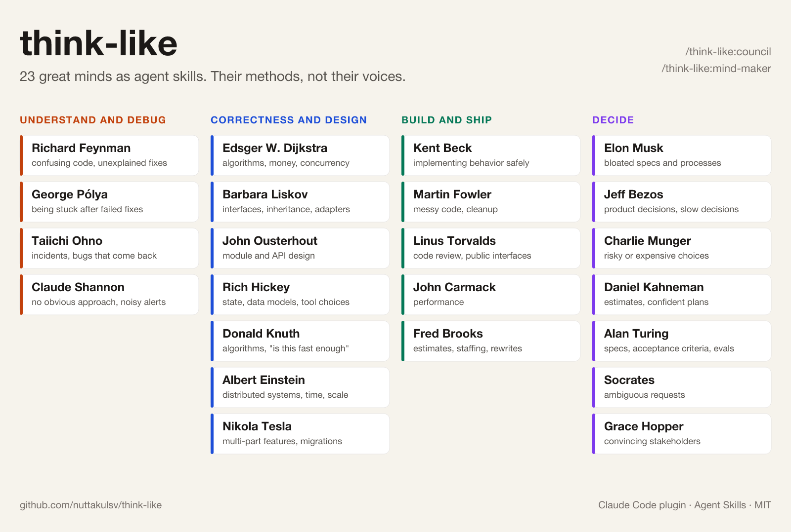

# think-like

[English](README.md) | ภาษาไทย

เอาวิธีทำงานของอัจฉริยะ 23 คนมาทำเป็น skill ให้ coding agent ทำตามจริง ไม่ใช่แค่เลียนแบบน้ำเสียง โอโนะจะให้ agent ไปดูหลักฐานแล้วถามว่าทำไมจนเจอต้นเหตุที่แก้ได้ ไดก์สตราจะให้เขียน invariant ก่อนจะเชื่อว่าโค้ดถูก มังเกอร์จะให้ถามก่อนว่าแผนนี้พังได้ยังไง และถ้าเรื่องใหญ่ ก็เรียกสภาให้หลายคนช่วยกันคิดแล้วเถียงกันให้เห็นชัด ๆ



```text
/plugin marketplace add nuttakulsv/think-like
/plugin install think-like@think-like
```

จากนั้นเรียกชื่อได้เลย หรือปล่อยให้ agent เลือกเองตามงาน

```text
/think-like:feynman อธิบาย src/billing/retry.ts ให้หน่อย
คิดแบบโอโนะ: เมื่อวานลูกค้า 37 คนโดนตัดเงินซ้ำ ช่วยเขียน postmortem
/think-like:council ไตรมาสนี้ควรแยก monolith เป็น microservices ไหม
```

## ทำไมถึงมี repo นี้

skill แนว "คนดัง" กำลังฮิต แต่หลายตัวเปลี่ยนแค่สไตล์การพูด agent พูดเหมือนคนดังคนนั้น แล้วก็ทำงานแบบเดิมที่มันจะทำอยู่แล้ว สนุกได้รอบเดียว

skill ในชุดนี้แต่ละตัวคือวิธีการ มันบอก agent ว่าต้องทำอะไร ลำดับไหน ต้องเช็กอะไร และคำตอบต้องมีอะไรบ้าง ชื่อคนเป็นแค่ป้ายของวิธีทำงานที่เขาเขียนไว้ในหนังสือ งานวิจัย หรือทอล์ก ซึ่งเราแนบลิงก์ไว้ทุกตัว สิ่งที่ได้คือนิสัยการทำงาน ไม่ใช่การแสดงเป็นเขา

ความต่างเห็นได้จากผลลัพธ์ ถาม agent ธรรมดาเรื่องตัดเงินซ้ำ ส่วนใหญ่จะได้วิธีแก้มาเลย แต่ถ้าใช้ `ohno` จะได้หลักฐานที่มันไปดูมา ลำดับคำถาม "ทำไม" ที่แต่ละขั้นบอกชัดว่ายืนยันแล้วหรือยังเป็นสมมติฐาน ต้นเหตุ และมาตรการสามระดับ คือหยุดความเสียหาย ป้องกันไม่ให้เกิดซ้ำ และตรวจจับให้เร็วขึ้น ดูตัวอย่างเต็มได้ที่ [examples/ohno-duplicate-charges.md](examples/ohno-duplicate-charges.md)

## รายชื่อ

| ใคร | สิ่งที่เปลี่ยนโลก | ทำให้ agent | ใช้ตอน |
|---|---|---|---|
| **เข้าใจและหาบั๊ก** | | | |
| [Richard Feynman](skills/feynman/SKILL.md) | ทฤษฎี QED, Feynman Lectures | อธิบายด้วยภาษาง่าย ๆ จดทุกจุดที่ยังไม่เข้าใจ และทดสอบสิ่งที่ทำนายได้ | โค้ดที่ไม่มีใครอธิบายได้ หรือแก้แล้วหายแต่ไม่รู้ทำไม |
| [George Pólya](skills/polya/SKILL.md) | หนังสือ *How to Solve It* | เขียนให้ชัดว่าโจทย์ถามอะไร มีข้อมูลอะไร ลองแก้กรณีง่ายก่อน แล้วย้อนตรวจ | ลองแก้ไปสองรอบแล้วยังไม่หาย |
| [Taiichi Ohno](skills/ohno/SKILL.md) | ระบบการผลิตแบบโตโยต้า | ไปดูหลักฐานจริง ถามทำไมจนเจอต้นเหตุที่แก้ได้ แล้ววางมาตรการ | incident และบั๊กที่กลับมาซ้ำ |
| [Claude Shannon](skills/shannon/SKILL.md) | ทฤษฎีสารสนเทศ | พลิกโจทย์หกแบบเพื่อหาทางใหม่ และแยกสัญญาณออกจากสิ่งรบกวน | ยังไม่มีแนวทางที่ใช่ หรือ alert เยอะจนไม่มีใครอ่าน |
| **ความถูกต้องและการออกแบบ** | | | |
| [Edsger W. Dijkstra](skills/dijkstra/SKILL.md) | อัลกอริทึม shortest path, structured programming | เขียนเงื่อนไขก่อนหลังและ invariant แล้วให้เหตุผลว่าถูกก่อนจะไปเทสต์ | อัลกอริทึม เงิน งานพร้อมกันหลายตัว |
| [Barbara Liskov](skills/liskov/SKILL.md) | data abstraction, behavioral subtyping | เขียนสัญญาจากมุมคนเรียก แล้วเช็กว่าทุก implementation สลับกันได้จริง | ออกแบบ interface หรือเปลี่ยน implementation |
| [John Ousterhout](skills/ousterhout/SKILL.md) | Tcl, Raft, *A Philosophy of Software Design* | หา module ที่ตื้นและความรู้ที่รั่วข้าม module แล้วลองออกแบบสองแบบ | ออกแบบ module และ API |
| [Rich Hickey](skills/hickey/SKILL.md) | Clojure, Datomic, ทอล์ก "Simple Made Easy" | หาเรื่องที่พันกันอยู่แล้วแยกออก ดัน side effect ไปไว้ขอบระบบ | state, data model, การเลือกเครื่องมือ |
| [Donald Knuth](skills/knuth/SKILL.md) | *The Art of Computer Programming*, TeX | ประเมินขนาดข้อมูลจริง เทียบอัลกอริทึม แล้ว optimize เฉพาะจุดสำคัญ | "แบบนี้เร็วพอไหม" |
| [Albert Einstein](skills/einstein/SKILL.md) | ทฤษฎีสัมพัทธภาพ | เขียนข้อสมมติทั้งหมด แล้วทดลองทางความคิดที่จุดสุดขั้วจากหลายมุมมอง | ระบบกระจาย เวลา การ scale |
| [Nikola Tesla](skills/tesla/SKILL.md) | มอเตอร์ไฟฟ้ากระแสสลับ | จำลองทั้งระบบในหัว ทั้งตอนปกติและตอนพัง ก่อนเขียนโค้ด | ฟีเจอร์ที่ผ่านหลายส่วน หรือการ migrate |
| **สร้างและส่งงาน** | | | |
| [Kent Beck](skills/beck/SKILL.md) | Extreme Programming, TDD | red, green, refactor ทีละก้าวเล็ก ๆ และจัดโค้ดให้เรียบร้อยก่อนเปลี่ยน | เปลี่ยน behavior อย่างปลอดภัย |
| [Martin Fowler](skills/fowler/SKILL.md) | หนังสือ *Refactoring* | ระบุ code smell แล้วใช้ refactoring ที่มีชื่อเรียก ทีละขั้นเล็ก ๆ | โค้ดรกก่อนเพิ่มฟีเจอร์ |
| [Linus Torvalds](skills/torvalds/SKILL.md) | Linux, Git | อ่าน diff ก่อน ตัดกรณีพิเศษด้วยโครงสร้างที่ดีกว่า และห้ามทำของที่คนใช้อยู่พัง | รีวิวโค้ด, interface สาธารณะ |
| [John Carmack](skills/carmack/SKILL.md) | Doom, Quake, กราฟิก 3D แบบ real-time | ตั้งเป้าตัวเลข วัดจริง ตัดงานทิ้ง แล้ววัดซ้ำ | performance |
| [Fred Brooks](skills/brooks/SKILL.md) | IBM System/360, *The Mythical Man-Month* | แยกความยากที่หลีกเลี่ยงไม่ได้ออกจากความยากที่เราสร้างเอง และนับเส้นทางการสื่อสารในทีม | ประเมินเวลา เพิ่มคน เขียนใหม่ |
| **การตัดสินใจ** | | | |
| [Elon Musk](skills/musk/SKILL.md) | จรวดที่นำกลับมาใช้ใหม่, รถยนต์ไฟฟ้า | ทุก requirement ต้องมีชื่อเจ้าของ ตัดทิ้ง ทำให้ง่าย ทำให้เร็ว แล้วค่อย automate | spec หรือ process ที่บวม |
| [Jeff Bezos](skills/bezos/SKILL.md) | Amazon, AWS | เขียนข่าวประกาศเปิดตัวก่อน แยกการตัดสินใจที่ย้อนได้กับย้อนไม่ได้ | ตัดสินใจเรื่องโปรดักต์ หรือเรื่องที่ค้างในห้องประชุม |
| [Charlie Munger](skills/munger/SKILL.md) | Berkshire Hathaway, mental models | คิดกลับด้าน ดูแรงจูงใจของทุกฝ่าย แล้วไล่ checklist อคติ | ทางเลือกที่เสี่ยงหรือแพง |
| [Daniel Kahneman](skills/kahneman/SKILL.md) | เศรษฐศาสตร์พฤติกรรม, *Thinking, Fast and Slow* | เริ่มจากสถิติงานที่คล้ายกัน ทำ pre-mortem และให้ค่าเป็นช่วง | ประเมินเวลา แผนที่ทุกคนมั่นใจเกินไป |
| [Alan Turing](skills/turing/SKILL.md) | รากฐานของวิทยาการคอมพิวเตอร์ | เปลี่ยนคำถามกว้าง ๆ ให้เป็นขั้นตอนที่ตัดสินได้ว่าผ่านหรือไม่ผ่าน | spec, acceptance criteria, eval ของฟีเจอร์ AI |
| [Socrates](skills/socrates/SKILL.md) | วิธีถามแบบโสเครตีส | ถามไม่กี่ข้อที่ทำให้ requirement จริงชัดขึ้น | คำขอที่กำกวม |
| [Grace Hopper](skills/hopper/SKILL.md) | compiler ยุคแรก, COBOL | ทำให้ต้นทุนจับต้องได้ และทำเดโมแทนการเถียง | โน้มน้าวหัวหน้าหรือผู้บริหาร |

ไม่แน่ใจว่าจะใช้ใคร พิมพ์ `/think-like:minds` เพื่อดูรายชื่อพร้อมคำแนะนำ หรือเล่าปัญหาแล้วถามว่าควรใช้ใครก็ได้

## สภาอัจฉริยะ (council)

```text
/think-like:council ควรย้ายไป serverless แล้วเซ็นสัญญา 3 ปีไหม
/think-like:council with Brooks, Kahneman and Bezos: ประเมินว่าเขียนแอปมือถือใหม่ 6 สัปดาห์ทันไหม
```

council จะเลือก 3–5 คนที่วิธีคิดเหมาะกับคำถาม หรือใช้คนที่คุณระบุ และจะมีอย่างน้อยหนึ่งคนที่น่าจะค้านทางที่คุณกำลังเอียงไป ทุกคนใช้ข้อเท็จจริงชุดเดียวกัน แต่ละคนให้มุมมอง สิ่งที่พบ และโหวตสั้น ๆ จากนั้นสรุปว่าเห็นตรงกันเรื่องไหน เห็นต่างเรื่องไหนและเพราะอะไร อะไรจะชี้ขาดได้ แล้วจบด้วยข้อเสนอเดียวพร้อมเงื่อนไขที่ควรกลับลำ ดูตัวอย่างเต็มที่ [examples/council-split-the-monolith.md](examples/council-split-the-monolith.md)

## สร้างอัจฉริยะของคุณเอง

```text
/think-like:mind-maker หัวหน้าทีมเก่าของฉัน จากบล็อกสามโพสต์นี้และ template design doc ของเขา
```

`mind-maker` จะเช็กเรื่องความยินยอมก่อน อ่านแหล่งข้อมูลที่ให้ไป สกัดออกมาเป็นตาราง (หน้าที่ที่ไม่ซ้ำใคร วิธีการ รูปแบบผลลัพธ์ สิ่งที่เขาไม่ทำ คำที่ใช้เรียก และคำพูดที่มีแหล่งอ้างอิง) แล้วเขียน `SKILL.md` ในรูปแบบเดียวกับตัวอื่นในชุด ถ้าเป็นคนที่ยังมีชีวิตจะใช้เฉพาะสิ่งที่เขาเผยแพร่เอง และถ้าเป็นบุคคลทั่วไปหรือครีเอเตอร์ จะถามก่อนว่าได้รับอนุญาตแล้วหรือยัง

## ใช้นอก plugin

- Claude Code แบบไม่ผ่าน marketplace: คัดลอกโฟลเดอร์ที่ต้องการไปไว้ใน skills ส่วนตัว เช่น `cp -r think-like/skills/feynman ~/.claude/skills/` แล้วเรียกเป็น `/feynman` ได้เลย ไม่ต้องมี `think-like:` นำหน้า
- claude.ai: zip โฟลเดอร์ skill ทีละตัว เช่น `skills/ohno` แล้วอัปโหลดเป็น custom skill ในหน้าตั้งค่า skill ของอัจฉริยะแต่ละคนใช้แค่ฟิลด์ frontmatter ตามมาตรฐาน [Agent Skills](https://agentskills.io) ส่วน `council` กับ `mind-maker` มี `argument-hint` เพิ่ม ซึ่ง Claude Code ใช้อยู่เจ้าเดียว
- agent อื่นที่อ่านโฟลเดอร์แบบ Agent Skills ได้ ก็โหลด `skills/<name>/SKILL.md` ไปใช้ได้เลย แต่ละตัวหา skill จากคนละที่ ต้องดูเอกสารของ agent นั้น

## หลักที่ใช้ทำชุดนี้

- **วิธีการ ไม่ใช่น้ำเสียง** ทุก skill มีหัวข้อเหมือนกัน: ใช้เมื่อไหร่, วิธีการ, รูปแบบผลลัพธ์, สิ่งที่ไม่ควรทำ, ตัวอย่าง (ระบุว่าเป็นตัวอย่างประกอบ) และแหล่งอ้างอิง
- **มีที่มาทุกอย่าง** ทุกคนมีรายการหนังสือ งานวิจัย ทอล์ก หรือจดหมาย ประโยคที่อยู่ในเครื่องหมายคำพูดต้องมีลิงก์ไปยังที่ที่เขาพูดจริง ที่เหลือเป็นการสรุปความ
- **คนที่ยังมีชีวิตใช้แค่หลักการของเขา** ไม่เลียนเสียงหรือบุคลิก และทุก skill แบบนี้ระบุชัดว่าไม่ได้เกี่ยวข้องหรือได้รับการรับรองจากเจ้าตัว
- **ติดตั้งทิ้งไว้ได้ไม่เปลือง** สิ่งที่อยู่ในรายการ skill ของ agent มีแค่ชื่อกับคำอธิบาย รวมทั้ง 26 skill ประมาณ 14,700 ตัวอักษร เนื้อหาเต็มจะโหลดตอนใช้เท่านั้น
- **ตอบเป็นภาษาของคุณ** ทุก skill ตอบตามภาษาที่คุณพิมพ์ และในคำอธิบายมีคำเรียกภาษาไทยด้วย เช่น "คิดแบบไฟน์แมน" "หาต้นเหตุ" "เรียกสภา"
- **ตรวจใน CI** `node scripts/validate.mjs` ตรวจ frontmatter ลำดับหัวข้อ แหล่งอ้างอิง ประโยคไม่เกี่ยวข้องสำหรับคนที่ยังมีชีวิต ตรวจว่ารายชื่อใน index และใน council ครบ และเช็กทุกลิงก์ใน repo

## คำถามที่พบบ่อย

**agent จะแกล้งเป็นคนพวกนี้ไหม** ไม่ มันทำตามวิธีการและส่งผลลัพธ์ตามที่วิธีนั้นกำหนด คนในประวัติศาสตร์อาจมีน้ำเสียงบ้างเล็กน้อย คนที่ยังมีชีวิตไม่มีเลย

**ใช้หลายคนพร้อมกันได้ไหม** ได้ เรียกหลายชื่อในคำสั่งเดียว เช่น "คิดแบบ Dijkstra กับ Torvalds รีวิว PR นี้" หรือใช้ council

**ทำไมเลือก 23 คนนี้** แต่ละคนมีหน้าที่ที่คนอื่นในชุดไม่ได้ทำ และวิธีของเขาเปลี่ยนสิ่งที่ agent ทำกับโค้ด ข้อมูล หรือการตัดสินใจได้จริง คนที่ดังแต่ไม่มีวิธีที่จับต้องได้ หรือวิธีซ้ำกับคนที่มีอยู่แล้ว ไม่ได้ใส่

**ทำไมไม่มีคนไทย** การใส่ครีเอเตอร์หรือวิศวกรไทยที่ยังมีชีวิตโดยไม่ได้รับอนุญาต เท่ากับเอาคำพูดใส่ปากเขา ถ้าคุณได้รับอนุญาตแล้ว ใช้ `mind-maker` ทำเองได้เลย

**สรุปวิธีการถูกต้องแค่ไหน** เป็นการสรุปสั้น ๆ สำหรับคนทำงาน ทุก skill มีแหล่งอ้างอิงแนบไว้ ถ้าจะใช้กับเรื่องสำคัญควรไปอ่านต้นฉบับด้วย

## ร่วมพัฒนา

ยินดีรับคนใหม่ แหล่งอ้างอิงที่ดีกว่า และการแก้ไขที่ผิด อ่าน [CONTRIBUTING.md](CONTRIBUTING.md) ก่อน คนใหม่ต้องมีหน้าที่ที่ไม่ซ้ำ มีแหล่งอ้างอิงชั้นต้น และผ่าน `node scripts/validate.mjs` วิธีร่างที่เร็วที่สุดคือใช้ `/think-like:mind-maker`

## ขอบคุณ

แนวคิดการทำวิธีทำงานของคนให้เป็น skill ของ agent เป็นที่รู้จักจาก [andrej-karpathy-skills](https://github.com/forrestchang/andrej-karpathy-skills), [ponytail](https://github.com/DietrichGebert/ponytail) และ [nuwa-skill](https://github.com/alchaincyf/nuwa-skill) ชุดนี้เลือกอีกทาง คือมีหลายคน ทุกวิธีกำหนดผลลัพธ์ที่ต้องได้ และมีแหล่งอ้างอิงทุกอย่าง โดยไม่ได้คัดลอกเนื้อหาจากโปรเจกต์เหล่านั้น

## ข้อจำกัดความรับผิดชอบ

think-like ไม่ได้เกี่ยวข้อง ไม่ได้รับการรับรอง และไม่ได้รับการสนับสนุนจากบุคคลที่มีชื่ออยู่ในชุดนี้ ทายาท หรือองค์กรที่เกี่ยวข้องกับเขา ชื่อถูกใช้เพื่อระบุแหล่งที่มาของแนวคิดที่แต่ละ skill อ้างอิงเท่านั้น

## License

[MIT](LICENSE)
